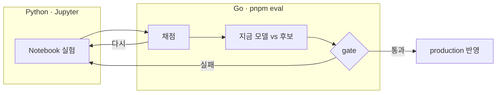

# snapdone

사진과 스크린샷을 넣으면 무엇을 하려던 것인지 알아채고, 그 일을 대신 끝내주는 앱.

## 구조

| 앱            | 스택                       | 로컬 주소               |
| ------------- | -------------------------- | ----------------------- |
| `apps/web`    | Next.js 16 (App Router)    | `http://localhost:3000` |
| `apps/mobile` | Expo SDK 56 + React Native | Expo (Metro)            |
| `apps/api`    | Go                         | `http://127.0.0.1:8080` |
| `apps/devhub` | Next.js 16 — 내부 도구     | `http://localhost:3100` |

## 시작하기

필요한 것: Node 24.14.0 (`.nvmrc`), pnpm 10.30.3, Go 1.26.6

lint · format · tsconfig 설정은 GitHub Packages의 `@berrypjh/*` 패키지에서 가져옴. **토큰이 없으면 `pnpm install`이 401로 실패함**

```bash
export GITHUB_TOKEN=<read:packages 권한이 있는 PAT>

nvm use
pnpm install

cp apps/web/.env.example apps/web/.env.local
cp apps/mobile/.env.example apps/mobile/.env
```

각 앱은 별도 터미널에서 실행

```bash
pnpm dev:web      # http://localhost:3000
pnpm dev:api      # http://127.0.0.1:8080
pnpm dev:mobile   # Expo (Metro)
pnpm dev:devhub    # DevHub (내부 도구) http://localhost:3100
```

`pnpm dev`는 web · api · devhub를 함께 실행. mobile은 대화형 프로세스라 따로 실행

## 검증

```bash
pnpm verify   # format:check -> lint -> typecheck -> test -> test:hooks -> build
```

개별 실행은 `pnpm lint`, `pnpm typecheck`, `pnpm test`, `pnpm build`.

```bash
pnpm e2e      # Playwright (브라우저 필요, verify에 미포함)
pnpm health   # API 연결 확인 (개발자용)
```

E2E 첫 실행 전에 브라우저를 한 번 설치

```bash
pnpm exec playwright install chromium firefox webkit
```

## 모델 평가

notebook에서 실험한 지시문 · 모델을 Go가 채점하고, gate를 통과하면 사람이 PR로 production에 반영



## 라이선스

MIT
